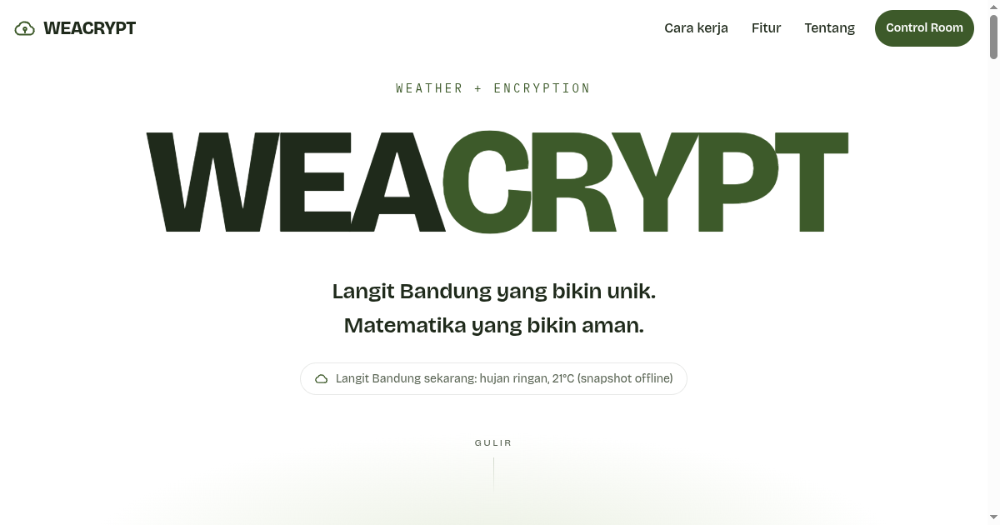

# WEACRYPT

**Weather Encryption.** Langit Bandung yang bikin unik, matematika yang bikin aman.

WEACRYPT adalah alat keamanan pribadi yang berjalan 100% di browser: buat password, cek kebocoran, segel pesan rahasia jadi link, kunci file, dan pecah seed phrase. Tanpa akun, tanpa server aplikasi, tanpa database. Cuaca Bandung dari OpenWeatherMap dipakai sebagai identitas visual dan "stempel" di setiap hasil, **bukan** sebagai sumber keamanan.



## Endpoint tugas

Endpoint OpenWeatherMap dari soal:

```
https://api.openweathermap.org/data/2.5/weather?q=Bandung&appid={KEY}
```

Aplikasi memanggilnya dengan tambahan `units=metric` (Celsius) dan `lang=id` (deskripsi Bahasa Indonesia). Hasilnya terlihat di:

- **Landing**: "Langit Bandung sekarang: hujan ringan, 21°C" dan kartu data cuaca.
- **Control Room** (`dashboard.html`): Sky Feed lengkap dan tombol **Lihat JSON mentah** yang menampilkan respons asli API.
- **Stempel cuaca** di setiap password, pesan tersegel, file terkunci, dan blok ledger.

Saat di-hosting di Vercel, browser memanggil proxy `api/weather` (Vercel Function), yang meneruskan ke endpoint di atas dengan API key dari environment variable. Saat dibuka lokal, browser memanggil OpenWeatherMap langsung.

## Menjalankan

### Lokal

```bash
python -m http.server 8080
# buka http://localhost:8080
```

Atau buka `index.html` langsung (mode `file://`). Semua alat tetap bekerja; satu-satunya batasan adalah link Sealed Message baru bisa dibuka penerima bila situsnya di-hosting (pakai blok armored untuk sementara).

Untuk data cuaca live saat lokal, isi `OWM_KEY` di `js/config.js`. Tanpa key, visual memakai snapshot statis Bandung dan semua alat tetap berfungsi.

### Deploy ke Vercel

1. Push folder ini ke repository Git (GitHub, GitLab, atau Bitbucket).
2. Di Vercel: **Add New → Project → Import** repository tersebut.
   - Framework Preset: **Other**. Tidak ada build command; biarkan default.
   - Root Directory: folder yang berisi `index.html` ini.
3. Di **Settings → Environment Variables**, tambahkan:
   - `OWM_KEY` = API key OpenWeatherMap (https://home.openweathermap.org/api_keys), untuk Production dan Preview.
4. Deploy. Bila env var ditambahkan setelah deploy pertama, lakukan **Redeploy**.

Cek setelah deploy:
- `https://<domain>/api/weather` mengembalikan JSON cuaca Bandung.
- `https://<domain>/about.html?selftest=1` menampilkan **Semua PASS**.
- DevTools → Network: hanya `api/weather` (domain sendiri) dan `api.pwnedpasswords.com` (saat cek kebocoran).

Catatan: di URL **preview**, Vercel menyisipkan toolbar dari `vercel.live` yang diblokir oleh CSP proyek ini, sehingga muncul error CSP di console. Ini tidak terjadi di production. Matikan lewat Project Settings → General → Vercel Toolbar bila mengganggu.

## Soal API key

- `js/config.js` → `OWM_KEY` **hanya untuk lokal** dan sengaja dibiarkan kosong di repository. Jangan commit key ke repo publik.
- Di Vercel, key disimpan sebagai environment variable `OWM_KEY` dan tidak pernah dikirim ke browser.
- Proxy mengunci kota ke Bandung dan di-cache CDN selama 10 menit (`s-maxage=600`), jadi OpenWeatherMap dipanggil paling banyak sekitar 6 kali per jam berapa pun jumlah pengunjungnya. Browser juga meng-cache 10 menit di `sessionStorage`.
- Key tugas akan di-rotate setelah penilaian.

## Fitur dan halaman

| Halaman | Fungsi |
|---|---|
| `index.html` | Landing scroll (GSAP): nama produk, cara kerja, fitur dan manfaat |
| `dashboard.html` | Control Room: Sky Feed, Entropy Pool, Quick Forge, ledger, checklist |
| `generate.html` | Key Forge: password, passphrase (EFF wordlist), PIN, kunci AES/token/UUID, bulk |
| `breach.html` | Breach Radar: cek kebocoran via Have I Been Pwned (k-anonymity, hanya 5 karakter hash yang dikirim) |
| `seal.html`, `open.html` | Sealed Message: pesan terenkripsi AES-256-GCM di URL fragment, mode link atau link + passphrase |
| `locker.html` | File Locker: enkripsi file lokal ke format `.ewall` |
| `split.html` | Secret Splitter: Shamir Secret Sharing k-dari-n |
| `ledger.html` | Entropy Ledger: hash chain dengan proof-of-work dan mode penyerang |
| `lab.html` | Attack Lab: membobol "kunci dari cuaca" dan uji randomness |
| `verify.html` | Integrity Checker: SHA-256/384/512 file dan teks |
| `about.html` | Cara kerja, model ancaman, FAQ, kredit, self-test (`?selftest=1`) |

Setiap halaman alat punya panduan **Cara pakai** langkah demi langkah.

## Kenapa cuaca tidak dipakai sebagai rahasia

Ide awal proyek ini adalah "kunci kriptografi dari data cuaca". Ide itu rusak:

1. Data OpenWeatherMap **publik**: siapa pun yang tahu kota dan jamnya mendapat angka yang sama.
2. Resolusinya **rendah**: tanpa API pun ruang kemungkinannya sekitar 2^48, jebol dalam hitungan jam dengan GPU. Attack Lab membuktikannya secara live.
3. Cloudflare LavaRand memakai kamera **privat** dan hanya sebagai input tambahan untuk entropi OS.

Maka di WEACRYPT, keamanan selalu datang dari 256 bit `crypto.getRandomValues()` dan algoritma standar (AES-GCM, PBKDF2-HMAC-SHA256 600.000 iterasi, HKDF-SHA256, SHA-256, Shamir di GF(2^8)). Cuaca hanya dicampur sebagai pembeda dan stempel.

## Struktur folder

```
├── index.html, dashboard.html, generate.html, breach.html, seal.html, open.html,
│   locker.html, split.html, ledger.html, lab.html, verify.html, about.html
├── api/weather.js          Vercel Function: proxy OpenWeatherMap (key di env var)
├── css/                    tokens, base, tools, dashboard, landing
├── js/
│   ├── config.js           konfigurasi (kota, endpoint, proxy)
│   ├── core/               ew, weather, theme, crypto, entropy, strength, hibp,
│   │                       shamir, ledger, stats, ui
│   ├── data/               EFF wordlist, daftar password umum
│   ├── workers/            Web Worker (Blob) untuk proof-of-work dan brute force
│   └── pages/              satu script per halaman
├── assets/                 ikon SVG, og-image
├── python/                 CLI offline (ewall_cli.py) + tes kompatibilitas
├── vercel.json             header keamanan (CSP, HSTS, frame-ancestors, dll.)
└── package.json            menandai api/ sebagai ES module (tanpa dependency)
```

Tanpa build step: HTML, CSS, dan JS dipisah per halaman dan bisa dibuka langsung. Pustaka CDN (GSAP, qrcode-generator, zxcvbn) dipin versinya dan memakai SRI.

## Python CLI

Kalau situs ini hilang, data tetap bisa dipulihkan offline. Lihat [`python/README.md`](python/README.md).

```bash
pip install -r python/requirements.txt
python python/ewall_cli.py decrypt locked-7f3a9c12.ewall
python python/ewall_cli.py shamir-combine shares.txt
python python/ewall_cli.py selftest
```

## Pengujian

- Browser: buka `about.html?selftest=1` (15 uji: vektor SHA-256, HKDF RFC 5869, PBKDF2 = Python, AES-GCM tamper, Shamir semua kombinasi, ledger tamper, uniformitas generator, dan lainnya).
- Python: `python -m unittest discover python/tests -v` (kompatibilitas file buatan browser ↔ CLI).

## Kredit dan lisensi

- Data cuaca: [OpenWeatherMap](https://openweathermap.org/).
- Cek kebocoran: [Have I Been Pwned, Pwned Passwords](https://haveibeenpwned.com/Passwords) (Troy Hunt).
- Wordlist: [EFF Large Wordlist](https://www.eff.org/dice), CC BY 3.0 US.
- Daftar password umum: SecLists (MIT).
- Animasi: [GSAP](https://gsap.com/) 3.12 + ScrollTrigger. QR: qrcode-generator (MIT). Estimasi kekuatan: zxcvbn (MIT).
- Font: Bricolage Grotesque, IBM Plex Mono (SIL OFL).
- Inspirasi: Cloudflare LavaRand.

Dibuat oleh Nafhan.
